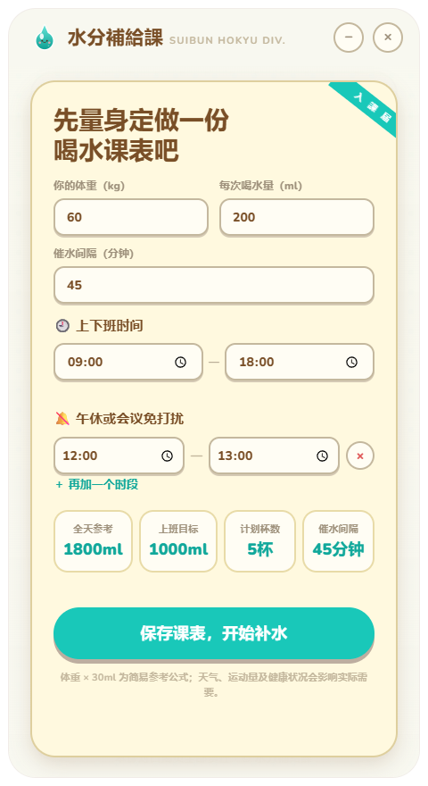
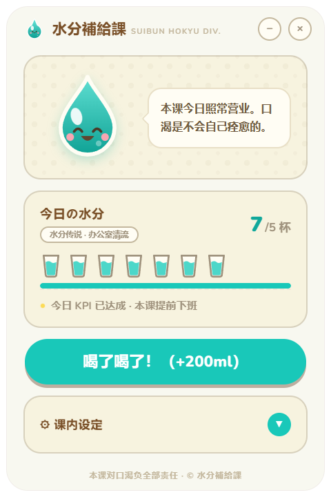
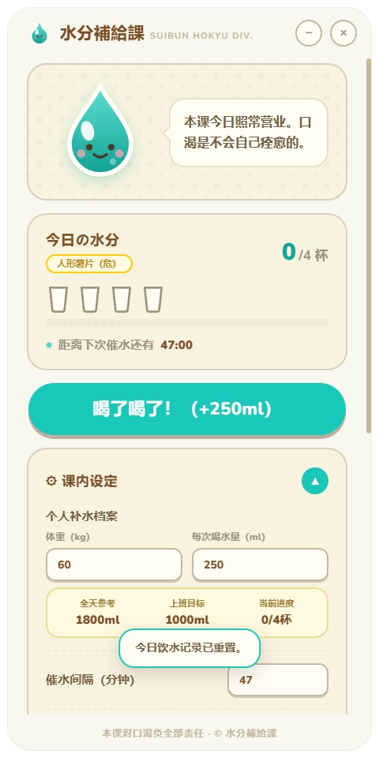
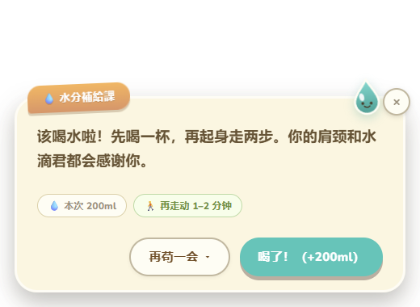
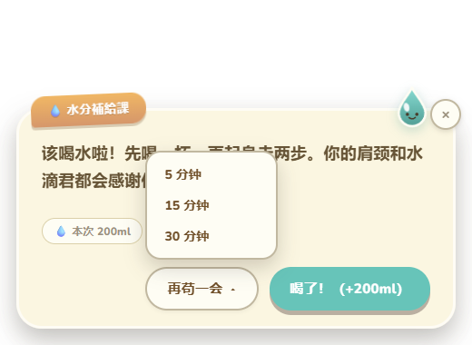

<p align="center">
  
</p>

<h1 align="center">水分補給課 · GokuGoku</h1>

<p align="center">
  一款常驻系统托盘、认真催上班族喝水的 Windows 桌面小应用。
</p>

<p align="center">
  <a href="https://github.com/mosaic-dng/GokuGoku/releases/latest"><strong>下载最新 Windows 便携版</strong></a>
  ·
  <a href="#从源码运行">从源码运行</a>
  ·
  <a href="#数据与隐私">数据与隐私</a>
</p>

> “GokuGoku（ゴクゴク）”是大口喝水时“咕嘟咕嘟”的拟声词。应用界面目前以简体中文为主。

## 它能做什么

- 根据体重估算全天饮水参考量，并按分钟级工作时长计算上班目标。
- 自定义每次喝水量、催水间隔、`HH:MM` 上下班时间与多个免打扰时段。
- 只在允许的工作时段提醒；周末、午休、会议或下班后保持安静。
- 提醒窗口会等待你选择喝水、关闭或延后 5、15、30 分钟，也可以附带起身活动提示。
- 主窗口、提醒窗口与托盘支持快速打卡，误点后可在短时间内撤销。
- 进度条、杯子、水滴君和提示信息带有克制的状态动效。
- 遵循 `prefers-reduced-motion`，减少漂浮、位移、打字机和弹跳效果。
- 所有个人设定与饮水数据仅保存在本机；应用本身不需要联网。

## 界面

### 首次设置

在空间充足的屏幕上，首次设置会以 `480 × 880` 单页呈现；可用高度不足时自动切换为不带滚动条的 `480 × 720` 两步设置。

<p align="center">
  
</p>

### 主界面与课内设置

<table>
  <tr>
    <td align="center"></td>
    <td align="center"></td>
  </tr>
  <tr>
    <td align="center">喝水进度、杯数与下一次提醒</td>
    <td align="center">体重、杯量、课表和免打扰设置</td>
  </tr>
</table>

### 催水提醒

<table>
  <tr>
    <td align="center"></td>
    <td align="center"></td>
  </tr>
  <tr>
    <td align="center">喝水、活动与本次杯量提示</td>
    <td align="center">选择 5、15 或 30 分钟后再提醒</td>
  </tr>
</table>

## 下载与使用

前往 [GitHub Releases](https://github.com/mosaic-dng/GokuGoku/releases/latest) 下载：

```text
GokuGoku-v1.3.0-Windows-x64.zip
```

解压 ZIP 后运行 `GokuGoku.exe`。这是免安装便携目录，请保留解压后的全部文件，不要只单独复制 EXE。

应用关闭主窗口后仍会驻留系统托盘。需要完全退出时，请使用托盘菜单中的“下课并退出”。

## 数据与隐私

配置、当日记录和历史数据保存在：

```text
%APPDATA%\水分補給課\gokugoku-data.json
```

想从头测试时，请先完全退出应用，再删除这个文件。下次启动会重新进入首次设置。

数据结构当前为 schema v3。升级旧数据时：

- v1、v2 的数字小时会自动转换为分钟级 `HH:MM` 字符串，例如 `9` → `09:00`。
- 迁移前分别保留 `gokugoku-data.v1.bak.json` 或 `gokugoku-data.v2.bak.json`。
- 如果同名备份已存在且内容不同，旧备份不会被覆盖，当前原始数据会保存为编号备份。
- 无法安全备份或写入时，应用会停止覆盖原文件并显示错误。

这些饮水目标只是日常参考，不构成医疗建议。天气、运动、饮食、药物和健康状况都可能影响实际饮水需要。

## 从源码运行

环境要求：

- Windows x64
- Node.js `22.12` 或更高版本
- npm

```powershell
git clone https://github.com/mosaic-dng/GokuGoku.git
cd GokuGoku
npm ci
npm test
npm start
```

更完整的零基础说明见 [构建教程](docs/BUILDING.md)。

## 测试与打包

```powershell
# 运行 Node 测试
npm test

# 生成 Windows x64 便携目录
npm run pack:win

# 审计真实便携包的体积、语言包、ASAR 和运行文件
npm run verify:win
```

当前 v1.3.0 验收结果：

- `76 / 76` 项自动化测试通过。
- Electron 验收覆盖 9 张截图，包括首次设置、两步设置、主界面、展开设置、喝水、撤销、提醒窗口和延后菜单。
- 便携目录约 `301.90 MiB`。
- 发布 ZIP 约 `126.07 MiB`。
- 生产目录仅保留 `zh-CN.pak` 与 `en-US.pak`。
- Chromium、GPU、D3D、Vulkan、ICU 与许可证文件均保留。

维护者发布新版本前请阅读 [Windows 发布说明](docs/RELEASING.md)。

## 项目结构

```text
main.js                     Electron 窗口、托盘、提醒调度与 IPC
preload.js                  安全 IPC 桥
lib/data.js                 schema v3、打卡、历史、重置与撤销
lib/hydration.js            目标、分钟级课表、免打扰与输入校验
lib/migration-backup.js     迁移前的冲突安全备份
lib/scheduler.js            可独立测试的提醒状态机
ui/index.*                  主窗口、首次设置与课内设置
ui/reminder.*               提醒窗口、打字机与撤销交互
scripts/pack-win.js         Windows 便携包构建与语言包裁剪
scripts/verify-*.js         包体和 Electron 截图验收
test/*.test.js              Node 内置测试
```

Release 的标签、ZIP 命名和发布检查详见 [发布流程](docs/RELEASING.md)。

## 友情链接

- [LINUX DO](https://linux.do)

## License

本项目使用 [MIT License](LICENSE)。

---

<details>
<summary>English summary</summary>

GokuGoku is a playful Windows hydration reminder that lives in the system tray. It supports minute-precise working hours, quiet periods, local-only drink tracking, undo, reduced motion, and a portable Windows x64 build.

Download the latest build from [GitHub Releases](https://github.com/mosaic-dng/GokuGoku/releases/latest). Hydration estimates are general references and are not medical advice.

</details>
